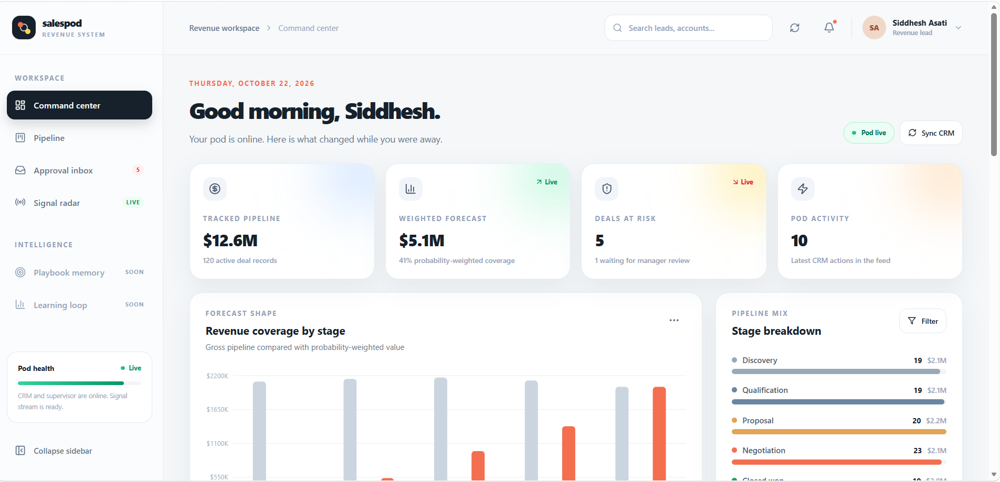
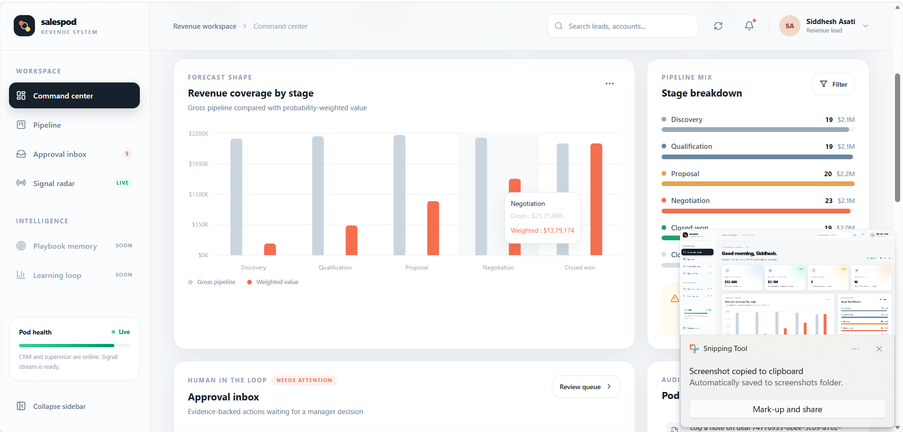
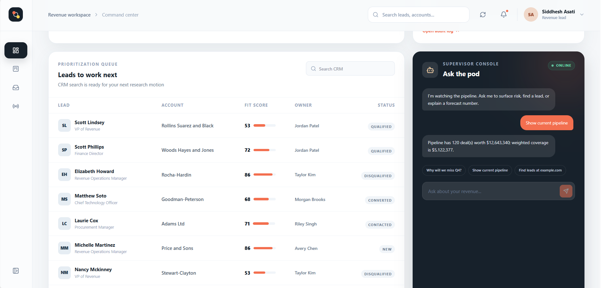

# Autonomous Sales Pod v2

[](https://www.python.org/downloads/)
[](https://github.com/jlowin/fastmcp)
[](https://github.com/langchain-ai/langgraph)
[](frontend/)
[](#offline-first--local-llm-architecture)

**Autonomous Sales Pod v2** is a production-oriented, offline-first AI revenue engine and manager command center. It unifies a deterministic synthetic CRM, transactional application services, a FastMCP tool boundary, a LangGraph-compatible supervisor flow, and an interactive executive dashboard.

The system ensures that autonomous agents cannot mutate CRM state unchecked: every state mutation flows through a transactional service with optimistic concurrency control, idempotency guards, and human-in-the-loop approvals.

---

## Visual Showcase & Features

### 1. Executive Command Center & Forecast Shape


The **Command Center** gives revenue leaders real-time visibility into pipeline health and pod activity:

- **Executive KPI Telemetry**: Real-time tracking of gross **Tracked Pipeline** ($12.6M across 120 deals), probability-adjusted **Weighted Forecast** ($5.1M coverage), active **Deals at Risk** (5 deals flagged, 1 awaiting manager intervention), and cumulative **Pod Activity** stream actions.
- **Revenue Coverage by Stage (Forecast Shape)**: Dynamic visual comparison of gross pipeline against probability-weighted forecast amounts across every stage of the sales cycle (Discovery, Qualification, Proposal, Negotiation, Closed Won).
- **Pipeline Mix & Stage Breakdown**: Live deal distribution across stages with deal counts and value summaries.
- **Pod Health & Connectivity**: Instant monitoring of CRM connectivity, supervisor graph status, and signal stream readiness with one-click CRM resynchronization.

---

### 2. Deep Forecast Analytics & Human-in-the-Loop (HITL) Governance


Autonomous execution requires enterprise-grade governance. Sales Pod balances autonomy with strict safety controls:

- **Granular Forecast Inspection**: Interactive hover drill-downs into stage metrics (e.g., inspecting the *Negotiation* stage showing $2,121,806 gross vs. $1,379,174 weighted value) to understand conversion probabilities.
- **Evidence-Backed Approval Inbox**: High-risk actions (such as deals missing an economic buyer, stalled negotiations, or sensitive account adjustments) are routed to the manager's review queue with grounded evidence from call transcripts and email history. Managers can approve or reject with decision notes before any deal is mutated.
- **Pod Activity & Immutable Audit Feed**: Complete chronological trace of every autonomous action, meeting logged, note appended, and stage transition executed by the agent pod.

---

### 3. Scored Lead Prioritization & AI Supervisor Console


Revenue teams get targeted guidance on where to spend effort, paired with an always-on conversational AI copilot:

- **Prioritization Queue ("Leads to work next")**: AI-scored lead workbench sorting prospects by fit score, company account, title, assigned pod owner, and lifecycle status (`QUALIFIED`, `CONTACTED`, `NEW`, `CONVERTED`, `DISQUALIFIED`) to guide the pod's next research or outreach motions.
- **Supervisor Console ("Ask the pod")**: An embedded conversational copilot connected directly to the CRM via typed FastMCP tools and LangGraph. Revenue managers can query pipeline status, ask analytical questions (e.g., *"Why will we miss Q4?"*, *"Show current pipeline"*, *"Find leads at example.com"*), and request guarded updates in natural language.

---

## Core Use Cases

| Use Case | Description | How It Works |
| :--- | :--- | :--- |
| **Pipeline & Forecast Intelligence** | Maintain accurate, real-time revenue forecasts without manual spreadsheet rollups. | The engine aggregates stage totals, applies deterministic probability weighting, and visualizes pipeline health against targets. |
| **Human-in-the-Loop Risk Intervention** | Prevent agent hallucinations or unauthorized changes from corrupting CRM data. | Risky deal transitions or unverified qualification claims generate approval inbox items backed by transcript citations for manager sign-off. |
| **Natural Language CRM Operations** | Query deals, leads, and company accounts conversationally from Slack, CLI, or the UI. | LangGraph supervisor routes user prompts through typed FastMCP tools (`search_leads`, `get_deal`, `get_pipeline_snapshot`). |
| **Intelligent Lead Prioritization** | Focus sales reps on accounts with the highest conversion likelihood. | Prospects are automatically evaluated, scored on fit, and queued for outreach motions with context-rich buyer profiles. |
| **Safe Transactional Deal Management** | Maintain strict data integrity under concurrent multi-agent and user operations. | All CRM mutations require version locking (`expected_version`) and idempotency keys to eliminate race conditions and double-writes. |

---

## System Architecture

```text
Manager / MCP Client / Frontend Dashboard
                │
                ├──────────────────────────────────────┐
                ▼                                      ▼
     FastMCP Adapter (stdio / HTTP)           Supervisor Graph (LangGraph)
                │                                      │
                └───────────────────┬──────────────────┘
                                    ▼
                         CRM Application Service
                (Validation · Concurrency · Idempotency)
                                    │
                                    ▼
                         SQLAlchemy Repositories
                                    │
                                    ▼
                         SQLite (dev) / Postgres (prod)
```

### Key Architectural Principles
- **Separation of Concerns**: The domain model has zero dependencies on FastMCP, LangGraph, Ollama, or SQLAlchemy.
- **Offline-First & Local LLMs**: Core CRM operations, tests, and supervisor flows run offline without cloud dependencies. When [Ollama](https://ollama.com/) is running, `qwen2.5:3b` performs natural language reasoning and `nomic-embed-text` powers playbook/knowledge retrieval.
- **Guarded Mutations**: MCP tools and agent flows cannot alter deal states without passing through optimistic concurrency checks (`expected_version`) and idempotency validation.
- **Separation of Ground Truth**: Synthetic seed data includes planted ground truth stored separately in `data/ground_truth.json` for objective agent evaluation; agents never have direct access to this evaluation file.

---

## FastMCP Tool Contracts

The pod exposes five typed MCP tools via FastMCP:

| Tool | Purpose | Mutation | Safety Mechanism |
| :--- | :--- | :---: | :--- |
| `search_leads` | Lexical lead and account search with cursor pagination | No | Read-only deterministic query |
| `get_deal` | Retrieve complete deal details, account, contacts, and stage history | No | Read-only aggregated view |
| `update_stage` | Guarded deal stage transition | **Yes** | Requires `expected_version` and idempotency key |
| `log_activity` | Append auditable note, call, meeting, or email activity | **Yes** | Validates actor, deal/lead IDs, and idempotency key |
| `get_pipeline_snapshot` | Aggregated stage counts and weighted revenue totals | No | Read-only summary snapshot |

---

## Quick Start

### Prerequisites
- **Python 3.11**
- **Node.js 18+** & npm (for the Command Center dashboard)
- Optional: [Ollama](https://ollama.com/) with `qwen2.5:3b` and `nomic-embed-text`

### 1. Environment Setup

```powershell
# Clone the repository and navigate to root
cd D:\salespod

# Create and activate virtual environment
py -3.11 -m venv .venv
.\.venv\Scripts\Activate.ps1

# Install package with development and agent dependencies
python -m pip install -e ".[dev,agents]"
```

### 2. Seed the Synthetic CRM

Generate 80 companies, 500 leads, 120 deals, 1,500 email threads, and 60 call transcripts with a deterministic seed:

```powershell
python -m scripts.seed_database --reset
```

*This creates `data/salespod.db` and the evaluation file `data/ground_truth.json`.*

### 3. Run the CLI Agent

Query the pod directly from the command line:

```powershell
python -m scripts.run_agent "Show the current pipeline snapshot"
python -m scripts.run_agent "Find leads at Acme"
```

### 4. Run the FastMCP Server

Expose the CRM tools over stdio to any MCP client (Claude Desktop, Cursor, etc.):

```powershell
python -m scripts.run_mcp_server
# or, after editable installation:
salespod-mcp
```

---

## Running the Command Center Dashboard

The repository includes a modern React/Vite/Tailwind dashboard in [`frontend/`](frontend/).

### Terminal 1: Backend API

```powershell
cd D:\salespod
.\.venv\Scripts\Activate.ps1
python -m scripts.run_api
```
*API runs at `http://127.0.0.1:8000`.*

### Terminal 2: Frontend Dev Server

```powershell
cd D:\salespod\frontend
npm install
npm run dev
```

Open [http://localhost:5173](http://localhost:5173) in your browser. The Vite dev server proxies `/api` calls directly to the FastAPI backend.

### Production Build

```powershell
cd D:\salespod\frontend
npm run build
npm run preview
```

---

## Local LLM Configuration (Ollama)

Sales Pod defaults to local Ollama endpoints:

```text
OLLAMA_BASE_URL=http://127.0.0.1:11434
OLLAMA_CHAT_MODEL=qwen2.5:3b
OLLAMA_EMBED_MODEL=nomic-embed-text
```

To use Ollama:
```powershell
ollama pull qwen2.5:3b
ollama pull nomic-embed-text
```

*Note: All core tests and deterministic routing work seamlessly even when Ollama is offline or not installed.*

---

## Verification & Code Quality

Run the test suite and linters:

```powershell
# Run offline unit, integration, and contract tests
python -m pytest

# Run Ruff linter and formatter checks
ruff check .
```


