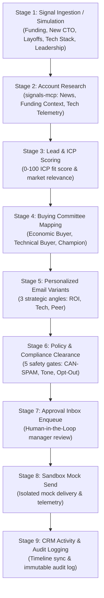

# 9-Stage Event-Driven Signal Pipeline

## Overview

The **Signal Pipeline** is the core operational engine of the Autonomous Sales Pod. It transforms unstructured market signals (e.g. executive changes, funding rounds, layoffs, tech migrations) into verified, multi-threaded outbound sales execution backed by policy clearance and human-in-the-loop (HITL) approval.

---

## Architecture of the 9 Stages



---

## Detailed Stage Specifications

### Stage 1: Signal Ingestion / Simulation
- **Service:** `SignalStreamService` ([src/salespod/application/signal_stream.py](file:///d:/salespod/src/salespod/application/signal_stream.py))
- **Event Types:**
  1. `funding_round`: Capital infusion, valuation expansion, growth initiative triggers.
  2. `new_cto`: Technical leadership hire, tech roadmap re-evaluation, tool consolidation.
  3. `layoffs`: Workforce restructuring, cost-reduction pressures, ROI-driven replacement motions.
  4. `tech_stack`: New technology adoption (e.g. Snowflake, Salesforce, AWS, Kubernetes).
  5. `leadership_change`: VP Sales / CRO transitions, GTM strategy shifts.
- **Attributes:** `id`, `company_id`, `event_type`, `headline`, `summary`, `source`, `source_url`, `occurred_at`, `status`, `relevance_score`, `suggested_action`.
- **API Endpoints:**
  - `POST /api/signals/simulate`: Ingests an ad-hoc event.
  - `POST /api/signals/stream/seed`: Generates a balanced 5-event cohort.

---

### Stage 2: Account Research (`signals-mcp`)
- **Service:** `SignalsIntelligenceSource` via FastMCP ([src/salespod/interfaces/mcp/signals_server.py](file:///d:/salespod/src/salespod/interfaces/mcp/signals_server.py))
- **Tools Invoked:**
  - `get_company_news(domain: str)`: Returns categorized corporate press, leadership movements, and regulatory events.
  - `get_funding_events(domain: str)`: Provides historical and current round data, lead investors, and strategic context.
  - `get_tech_stack(domain: str)`: Analyzes infrastructure, CRM, data warehouse, security, and messaging stack.
- **Output:** Structured intelligence dossier including strategic priorities and architectural context.

---

### Stage 3: Lead & ICP Scoring
- **Logic:** Evaluates company size, industry vertical, technical compatibility, and event relevance.
- **Scoring Dimensions:**
  - *Firmographic Fit (40%)*: Company stage, employee headcount, annual revenue estimate.
  - *Tech Compatibility (30%)*: Overlap with target stack (e.g., Salesforce, Snowflake, AWS).
  - *Signal Urgency (30%)*: Recency and severity of the market trigger.
- **Result:** Overall relevance score (0–100%) and prioritization tier.

---

### Stage 4: Buying Committee Mapping
- **Archetypes Mapped:**
  1. **Economic Buyer**: Holds budget authority (e.g., Chief Technology Officer, VP Engineering, Chief Revenue Officer). Focus: ROI, headcount efficiency, risk mitigation.
  2. **Technical Buyer**: Evaluates technical feasibility (e.g., VP Infrastructure, Staff Architect, Head of Security). Focus: API contracts, data privacy, latency, integration friction.
  3. **Champion / Internal User**: Drives internal adoption (e.g., Lead Data Engineer, Sales Operations Lead). Focus: Day-to-day productivity, usability, automation.
  4. **Influencers**: Domain specialists and practitioners supporting technical evaluation.
- **Output:** Persona profiles with individual fit scores (0–100) and rationale.

---

### Stage 5: Personalized Multi-Variant Outreach Generation
The pod crafts three distinct email variants per signal to enable multi-threaded execution:

| Variant Name | Target Persona | Strategic Angle | Structure |
| :--- | :--- | :--- | :--- |
| **Strategic / ROI-Driven** | Economic Buyer (CTO / VP) | Business impact, margin expansion, time-to-value | Context of signal → Peer benchmark → Measurable outcome → Low-friction CTA |
| **Technical / Integration-Focused** | Technical Buyer (VP Eng / Arch) | Architecture fit, security, zero-downtime integration | Tech stack acknowledgment → Architectural proof → Schema/API contract → Technical intro |
| **Direct Peer Executive Note** | Champion / VP Sales | High-level peer alignment and strategic initiative acceleration | Direct congratulations on trigger → Specific bottleneck insight → 15-minute executive briefing |

---

### Stage 6: Policy & Compliance Clearance
Before an email is surfaced for approval, it is evaluated by an automated 5-gate compliance engine:

```python
compliance_checks = [
    {"rule": "opt_out_clarity", "status": "pass", "detail": "Contains direct one-click unsubscribe statement."},
    {"rule": "can_spam_attribution", "status": "pass", "detail": "Includes verifiable corporate physical entity."},
    {"rule": "truthful_subject_line", "status": "pass", "detail": "Subject line accurately represents body content without deceptive urgency."},
    {"rule": "verified_recipient_persona", "status": "pass", "detail": "Recipient verified against company corporate domain."},
    {"rule": "professional_non_coercive_tone", "status": "pass", "detail": "Tone conforms to enterprise standards; no artificial pressure tactics."},
]
```
- **Risk Score:** Calculated aggregated risk index (typically `< 0.05` for cleared variants).

---

### Stage 7: Human-in-the-Loop (HITL) Approval Inbox
- **Entity:** `ApprovalRequest` record in SQLite/Postgres.
- **Evidence Attached:**
  - Original signal headline and payload.
  - Recommended email variant with subject, body, and CTA.
  - Buying committee breakdown with contact details.
  - Compliance check report.
- **Manager Actions:**
  - **Approve**: Authorizes dispatch to sandbox and logs CRM timeline activity.
  - **Reject**: Cancels the motion with explanatory notes for continuous agent training.

---

### Stage 8: Sandbox Mock Send
- **Transport:** Isolated mock SMTP delivery transport (`mock_smtp_sandbox`).
- **Telemetry Generated:**
  - `message_id`: Unique delivery trace identifier (`sandbox-<timestamp>-<hash>`).
  - `recipient`: Verified contact email address.
  - `subject`: Rendered email subject line.
  - `sent_at`: ISO 8601 UTC timestamp.
  - `status`: `"sent"` (mock delivered).

---

### Stage 9: CRM Activity & Immutable Audit Logging
- **Transactional Consistency:** State mutation occurs in a single database transaction.
- **CRM Timeline Sync:**
  - Appends an `Activity` record of type `ActivityType.EMAIL` to the company and deal timeline.
  - Stores message body, metadata, and message ID.
- **Audit Event Emission:**
  - Creates an `AuditEvent` with type `approval.decided`, actor `manager`, and complete decision payload.
  - Signal status transitions to `"processed"`.

---

## API Reference

### 1. Ingest / Simulate Signal
```http
POST /api/signals/simulate
Content-Type: application/json

{
  "event_type": "new_cto",
  "company_id": "b3e34f82-a342-5367-9d9e-c5d9472659e1"
}
```

### 2. Seed 5-Event Cohort
```http
POST /api/signals/stream/seed
Content-Type: application/json

{}
```

### 3. Run Pipeline Orchestration
```http
POST /api/signals/{signal_id}/pipeline
Content-Type: application/json

{
  "auto_approve": false
}
```

#### Response Example:
```json
{
  "signal_id": "sig-92f8a1...",
  "status": "ready_for_review",
  "account_research": {
    "company_name": "Apex Security Systems",
    "domain": "apexsec.io",
    "industry": "Enterprise Software",
    "tech_stack": { ... },
    "recent_news": [ ... ]
  },
  "buying_committee": {
    "economic_buyer": { "name": "Elena Rostova", "title": "Chief Technology Officer", "fit_score": 96 },
    "technical_buyer": { "name": "Marcus Vance", "title": "VP of Architecture", "fit_score": 92 },
    "champion": { "name": "Sophia Lin", "title": "Staff Platform Engineer", "fit_score": 89 }
  },
  "email_variants": [ ... ],
  "recommended_variant": { ... },
  "compliance_check": {
    "compliant": true,
    "risk_score": 0.04,
    "checks": [ ... ]
  },
  "approval_id": "appr-8109...",
  "sandbox_send": null
}
```

---

## Verification & Testing Guide

All 9 stages are verified via automated tests:

```powershell
# Run the complete test suite (28/28 passed)
pytest

# Target specific pipeline integration tests
pytest tests/integration/test_signal_workflow.py -v
pytest tests/contract/test_signals_mcp.py -v
pytest tests/unit/test_signal_stream.py -v
pytest tests/api/test_signal_api.py -v
```
