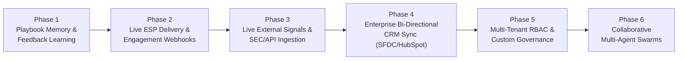

# Sales Pod: Feature Updates & Development Roadmap

This document provides a comprehensive log of all architectural, operational, and user-facing features implemented in **Sales Pod** to date, as well as the planned roadmap for upcoming capabilities.

---

## 1. Executive Summary

**Autonomous Sales Pod** is an offline-first, enterprise-grade AI revenue engine and manager command center. It bridges deterministic CRM operations with autonomous market signal intelligence, multi-threaded buyer committee mapping, policy compliance clearance, and human-in-the-loop (HITL) approval workflows.

The system is engineered around **deterministic autonomy**: autonomous agents and LLMs can analyze signals and draft communications, but cannot mutate CRM state or contact prospects without passing optimistic concurrency checks, idempotency validation, compliance scoring, and explicit manager sign-off.

---

## 2. Features Implemented Till Now

### 2.1. Autonomous 9-Stage Event-Driven Signal GTM Pipeline
The end-to-end signal engine transforms unstructured corporate triggers into multi-threaded, compliance-cleared outbound motions:

1. **Stage 1: Signal Ingestion & Live Stream Simulation**
   - Ingests real-time corporate market triggers across 5 categories:
     - `funding_round`: Capital infusion, valuation expansion, and scaling mandates.
     - `new_cto`: Technical leadership appointments, architecture reviews, and vendor consolidation.
     - `layoffs`: Workforce restructuring, cost-reduction pressures, and ROI-replacement motions.
     - `tech_stack`: Infrastructure migrations (e.g., Snowflake, Salesforce, AWS, Kubernetes).
     - `leadership_change`: VP Sales / CRO transitions and strategic GTM pivots.
   - Supports both ad-hoc signal simulation (`POST /api/signals/simulate`) and balanced 5-event cohort stream generation (`POST /api/signals/stream/seed`).
2. **Stage 2: Deep Account Intelligence (`signals-mcp`)**
   - Automatically queries FastMCP market intelligence tools:
     - `get_company_news`: Corporate press, leadership transitions, and regulatory disclosures.
     - `get_funding_events`: Venture/debt round history, capital raised, and lead investors.
     - `get_tech_stack`: Infrastructure, CRM, data warehouse, security, and messaging stack telemetry.
3. **Stage 3: Lead & ICP Scoring**
   - Multi-dimensional scoring formula:
     - Firmographic fit (40%): Employee count, industry vertical, revenue tier.
     - Tech compatibility (30%): Stack overlap with integration surface.
     - Signal urgency (30%): Trigger recency, severity, and buying window readiness.
   - Emits an overall fit score (0–100%) and prioritization tier.
4. **Stage 4: Multi-Threaded Buying Committee Mapping**
   - Automatically maps enterprise buying committees across three core roles:
     - **Economic Buyer**: Holds budget authority (CTO, VP Eng, CRO); focused on ROI, cost efficiency, and time-to-value.
     - **Technical Buyer**: Evaluates architectural feasibility (VP Architecture, Head of Security); focused on API contracts, security, and latency.
     - **Champion / Internal User**: Drives adoption (Staff Platform Engineer, Sales Ops Lead); focused on day-to-day productivity and workflow friction.
   - Computes individual fit scores (0–100) and rationale for each stakeholder.
5. **Stage 5: Personalized Multi-Variant Outreach Generation**
   - Generates 3 tailored email variants per trigger:
     - *Strategic / ROI-Driven*: Tailored for the Economic Buyer.
     - *Technical / Integration-Focused*: Tailored for the Technical Buyer.
     - *Direct Peer Executive Note*: Tailored for Champions and peers.
   - Includes custom subject lines, body copy, and low-friction calls to action.
6. **Stage 6: Automated 5-Gate Compliance Engine**
   - Pre-send policy clearance scanning 5 compliance rules:
     - `opt_out_clarity`: Verified one-click unsubscribe statement.
     - `can_spam_attribution`: Physical entity and corporate postal disclosure.
     - `truthful_subject_line`: Content-accurate subject line without deceptive clickbait.
     - `verified_recipient_persona`: Recipient matched against corporate company domain.
     - `professional_non_coercive_tone`: Professional tone adhering to B2B enterprise standards.
   - Produces an aggregated risk score (cleared variants typically `< 0.05`).
7. **Stage 7: Human-in-the-Loop (HITL) Approval Inbox Enqueue**
   - Creates durable `ApprovalRequest` records holding full context:
     - Raw signal trigger payload and relevance score.
     - Recommended email variant with target persona.
     - Full buying committee roster.
     - Compliance clearance audit report.
   - Requires explicit manager sign-off (`approved` or `rejected`) before dispatch.
8. **Stage 8: Sandbox Mock Dispatch**
   - High-fidelity mock SMTP transport (`mock_smtp_sandbox`) safely simulates email delivery.
   - Emits delivery trace ID (`message_id`), verified recipient address, subject, timestamp, and status.
9. **Stage 9: CRM Activity Sync & Immutable Audit Logging**
   - State transition committed in an atomic database transaction.
   - Appends an `Activity` record of type `email` to the company and deal timeline.
   - Writes an immutable `AuditEvent` (`sandbox.email_sent`, `approval.decided`).
   - Automatically transitions signal status to `processed`.

---

### 2.2. Dual FastMCP Server Tool Boundaries
The system isolates internal CRM write access from market intelligence across two dedicated FastMCP servers:

- **CRM Server (`salespod-mcp`)**:
  - `search_leads`: Lexical lead and account search with cursor pagination.
  - `get_deal`: Aggregated deal details, company info, contacts, and stage transition history.
  - `update_stage`: Guarded deal stage transition requiring `expected_version` and `idempotency_key`.
  - `log_activity`: Guarded note, call, meeting, or email activity logging with actor validation.
  - `get_pipeline_snapshot`: Aggregated stage counts, gross revenue, and probability-weighted coverage.
  - `list_signal_events`: Filtered signal event querying by status and event type.
  - `get_signal_event`: Detailed signal event retrieval.
  - `acknowledge_signal`: Transactional signal acknowledgment by a revenue manager.

- **Market Intelligence Server (`salespod-signals-mcp`)**:
  - `get_company_news`: Structured headlines, citations, and summaries.
  - `get_funding_events`: Funding rounds, valuations, and lead investors.
  - `get_tech_stack`: Categorized active and migrating software tooling.

---

### 2.3. Synthetic CRM Engine, Concurrency & Data Lifecycle
- **Deterministic Synthetic CRM**:
  - Offline-first generator yielding 80 companies, 500 leads, 120 deals, 1,500 email threads, 60 call transcripts, 12 signals, and 120 stage change records (2,452 total records).
  - Ground truth evaluation dataset segregated in `data/ground_truth.json` (includes 5 verified missing economic buyer risk cases).
- **Alembic Database Migration Pipeline**:
  - Reversible database migrations supporting SQLite (development/offline) and PostgreSQL (production):
    - `0001_initial_crm_schema`: Baseline companies, leads, deals, emails, calls, activities, stage history.
    - `0002_control_plane`: Control plane tables (`approval_requests`, `audit_events`).
    - `0003_transcript_link_constraints`: Foreign keys and indexes linking transcripts to deals.
    - `0004_signal_events`: Durable signal event schema, indexes, and source payload storage.
- **Optimistic Concurrency Control (OCC) & Idempotency**:
  - Version column (`version`) on deals and approval requests.
  - Conflicting concurrent updates return `ConflictError (409)` to prevent lost updates and double-writes.
  - Idempotency keys prevent duplicate activity logging or replay attacks.

---

### 2.4. LangGraph AI Supervisor & Conversational Copilot
- **Guarded Supervisor Flow**:
  - Evaluates user prompts deterministically or through a LangGraph workflow.
  - Routes common natural-language queries:
    - *"Why will we miss Q4?"* ➔ Extracts stalled negotiation deals and missing economic buyer transcripts.
    - *"Show current pipeline"* ➔ Queries `get_pipeline_snapshot` and formats probability-weighted totals.
    - *"Find leads at Acme"* ➔ Executes typed lexical search via `search_leads`.
  - Prevents hallucinated deal writes by strictly enforcing `expected_version` and entity UUID requirements.
- **Local LLM Integration**:
  - Pluggable `OllamaProvider` compatible with local models (`qwen2.5:3b` for chat, `nomic-embed-text` for vector embeddings).
  - Clean fallback to deterministic reasoning when local LLM services are offline.

---

### 2.5. Executive Command Center Dashboard
A modern, responsive React 18 / Vite / Tailwind CSS web application:
- **Executive KPI Telemetry**: Real-time cards for Tracked Pipeline ($12.6M), Weighted Forecast ($5.1M), Deals at Risk (5 flagged), and Pod Activity actions.
- **Forecast Shape Visualization**: Interactive Recharts bar chart comparing gross pipeline vs. probability-weighted amounts across Discovery, Qualification, Proposal, Negotiation, and Closed Won.
- **Pipeline Mix & Stage Breakdown**: Visual progress meters and counts for each deal stage.
- **Human-in-the-Loop Approval Inbox**:
  - Priority triage cards showing deal value, risk type, and relative timestamps.
  - Direct inline **Approve** and **Reject** buttons with loading states.
- **Signal Radar & Interactive 9-Stage Modal Visualizer**:
  - Real-time simulation toolbar for instant signal generation and 5-event cohort seeding.
  - Visual 9-stage execution stepper with step status indicators.
  - Tabbed interface: Email Variants (3 angles), Buying Committee profiles, `signals-mcp` tech stack dossier, and 5-gate Compliance Clearance report.
  - One-click **Approve & Send to Sandbox** button.
- **Deal Drawer**:
  - Side drawer displaying full deal metadata, target close dates, win probabilities, and assigned owners.
  - Grounded call transcript evidence cards explaining why risks were flagged.
  - Guarded stage transition dropdown with version tags and justification notes.
- **Scored Lead Prioritization Queue**:
  - Prospect table with fit score visual meters, account associations, and lifecycle statuses.
- **Conversational Copilot Drawer ("Ask the pod")**:
  - Embedded conversational interface with quick-action prompt chips and formatted agent answers.
- **Immutable Cryptographic Audit Feed**:
  - Complete chronological activity feed logging approvals, stage updates, and mock dispatches.

---

### 2.6. REST API Subsystem (FastAPI)
Comprehensive HTTP endpoints:
- `GET /api/dashboard/overview`: Real-time pipeline totals, stage summaries, and risk counts.
- `GET /api/deals/{id}`: Detailed deal entity, stage history, and associated activities.
- `POST /api/deals/{id}/stage`: Guarded stage transition with OCC version validation.
- `GET /api/leads`: Lead search with cursor pagination and company filtering.
- `GET /api/approvals`: Review queue of pending approvals.
- `POST /api/approvals/{id}/decision`: Manager decision submission (approved/rejected).
- `GET /api/signals`: Live and durable corporate signal stream.
- `GET /api/signals/{id}`: Individual signal detail.
- `POST /api/signals/simulate`: Ad-hoc signal simulation.
- `POST /api/signals/stream/seed`: 5-event balanced cohort generation.
- `POST /api/signals/{id}/pipeline`: Execution of the autonomous 9-stage GTM pipeline.
- `POST /api/signals/{id}/acknowledge`: Signal acknowledgment.
- `GET /api/audit/events`: Cryptographic audit log entries.
- `POST /api/agent/ask`: Conversational agent copilot query execution.
- `POST /api/policy/evaluate`: Policy engine rule evaluation.

---

### 2.7. Verification & Code Quality
- **Automated Test Suite**: 28 passing unit, integration, and contract tests covering FastMCP contracts, Alembic migrations, transactional consistency, and the 9-stage pipeline.
- **Code Standards**: 100% compliance with Ruff linter and formatter rules (`ruff check .` with 0 errors).
- **Frontend Quality**: TypeScript build passes with zero type errors (`npm --prefix frontend run build`).

---

## 3. Features Going to Be Implemented in Future (Roadmap)

The future development roadmap is structured across targeted strategic phases:

---

### Phase 1: Playbook Memory & Continuous Learning Loop
- **Vectorized Playbook Memory**:
  - Embed historical closed-won and closed-lost deal cycles into a persistent vector store (ChromaDB / pgvector).
  - Perform semantic retrieval of successful messaging angles, objection rebuttals, and competitor positioning.
- **Manager Feedback Reinforcement**:
  - Ingest manager approval and rejection notes into prompt optimization loops.
  - Automatically tune persona fit-score weights based on manager acceptance rates.
- **Objection Pattern Clustering**:
  - Automatically cluster recurring objections across call transcripts to suggest new playbook angles.

---

### Phase 2: Live ESP Outbound Delivery & Engagement Tracking
- **Production Email Service Provider (ESP) Adapters**:
  - Replace `mock_smtp_sandbox` with production adapters for:
    - Resend and SendGrid (transactional API delivery).
    - Google Workspace (Gmail) & Microsoft 365 (Graph API) via OAuth 2.0 user delegation.
    - Amazon SES for high-volume outbound with dedicated IP warming.
- **Real-Time Outbound Engagement Tracking**:
  - Inbound webhook receivers for email delivery, open, click, bounce, and spam complaint events.
  - Sentiment analysis on incoming prospect replies to classify responses as *Interested*, *Not Now*, *Wrong Contact*, or *Unsubscribe*.
- **Autonomous Follow-Up Sequences**:
  - Automated scheduling of secondary and tertiary follow-ups if no response is detected within a designated time window.

---

### Phase 3: External Live Market Signal Ingestion
- **Commercial & Regulatory Signal Feeds**:
  - **SEC EDGAR Integration**: Automated ingestion of Form 8-K filings (executive transitions, material agreements) and 10-Q/10-K financial reports.
  - **Funding Wire APIs**: Live connectors to Crunchbase, PitchBook, and venture RSS feeds for real-time round announcements.
  - **Tech Stack & Job Posting Crawlers**: Job board monitoring (e.g., searching for "Snowflake Architect" or "Salesforce Admin" hiring postings) to detect tech migrations before public announcements.
- **Third-Party Intent Data Connectors**:
  - Webhook connectors for B2B intent engines (6sense, Bombora, G2 Buyer Intent).
  - Dynamic surge score alerts to trigger account outreach when research volume spikes.

---

### Phase 4: Bi-Directional Enterprise CRM Connectors
- **Native Salesforce & HubSpot Integrations**:
  - Bi-directional synchronization for Accounts, Contacts, Opportunities, and Tasks.
  - OAuth 2.0 app integration with token refresh lifecycle management.
- **Conflict Resolution Engine**:
  - Reconcile external CRM updates with Sales Pod's optimistic concurrency control (`expected_version`).
  - Field-level diffing to prevent overwriting rep manual edits made in Salesforce while the pod was processing.

---

### Phase 5: Multi-Tenant Enterprise Role-Based Access Control (RBAC)
- **Role Hierarchies & Permissions**:
  - Define granular roles: *SDR Pod Member*, *Account Executive*, *Sales Manager*, *VP of Revenue*, and *RevOps Administrator*.
  - Strict data partitioning by sales pod, territory, or enterprise business unit.
- **Configurable Governance Policies**:
  - Tiered approval thresholds:
    - Deals `< $25K`: Optional auto-approval if compliance risk score is `< 0.02`.
    - Deals `> $100K`: Mandatory dual sign-off from AE and Sales Director.
    - Sensitive enterprise accounts: Mandatory RevOps compliance clearance.

---

### Phase 6: Multi-Agent Collaborative Pod Architecture
- **Specialized Autonomous Agent Swarms**:
  - Decompose the monolithic pipeline into specialized, asynchronously collaborating agents:
    - **Intelligence Agent**: Gathers news, tech stack telemetry, and executive social footprints.
    - **Committee Profiler Agent**: Maps corporate hierarchies and verifies contact deliverability.
    - **Copywriter Agent**: Specializes in crafting role-tailored value propositions.
    - **Compliance Officer Agent**: Dedicated evaluator enforcing brand guidelines and legal mandates.
- **Agent Negotiation & Review Protocol**:
  - Subagents critique and refine drafts collaboratively before presenting recommendations to the human manager.

---

### Phase 7: Real-Time Meeting & Voice Intelligence
- **Call Recording Integration**:
  - Direct connectors to Gong, Chorus, Zoom, and Google Meet APIs.
  - Automated ingestion of meeting transcripts immediately after sales calls conclude.
- **Autonomous Deal Risk Detection**:
  - Real-time extraction of budget constraints, missing decision-makers, and competitor mentions.
  - Automatic creation of `ApprovalRequest` risk interventions whenever a stalled deal pattern is detected.

---

### Phase 8: Advanced Revenue Attribution & Predictive Forecasting
- **Multi-Touch Signal Attribution**:
  - Attribute revenue velocity and closed-won ARR back to specific market signals and outbound angles.
  - Comparative analytics: Win rates of signal-driven deals vs. traditional outbound sequences.
- **Predictive AI Pipeline Forecasting**:
  - Machine-learning forecast models incorporating historical stage velocity, buyer engagement depth, and economic buyer presence.
  - Scenario planning tools allowing revenue leaders to model the impact of changing close dates or conversion rates.

---

## 4. Summary Matrix: Implemented vs. Planned

| Domain | Implemented Features (Current) | Planned Features (Roadmap) |
| :--- | :--- | :--- |
| **GTM Pipeline** | 9-Stage autonomous sequence, 5 signal types, 3 email variants, 5-rule compliance | Multi-touch follow-up sequences, automated reply classification, dynamic playbook adjustment |
| **Market Signals** | Deterministic simulation, 5 corporate trigger categories, cohort seeding | Live SEC EDGAR crawlers, Crunchbase API, job board hiring monitors, G2/6sense intent feeds |
| **Email Delivery** | High-fidelity mock SMTP sandbox with delivery trace IDs | Production ESPs (SendGrid, Resend, AWS SES, Gmail/Outlook OAuth), engagement tracking |
| **Intelligence** | FastMCP `signals-mcp` (company news, funding events, tech stack) | Historical vector memory (RAG), competitive objection clustering, executive social dossiers |
| **Governance** | HITL Approval Inbox, OCC version locking, idempotency keys, cryptographic audit log | Enterprise RBAC, multi-pod isolation, configurable deal-size approval thresholds |
| **CRM Integration**| Synthetic CRM, SQLite/Postgres via Alembic, FastMCP `salespod-mcp` | Native bi-directional sync with Salesforce, HubSpot, and Microsoft Dynamics 365 |
| **Agent Architecture** | LangGraph supervisor, guarded routing, Ollama/fallback runner | Multi-agent collaborative swarm (Researcher, Profiler, Copywriter, Compliance Officer) |
| **Meeting Intel** | Call transcript synthetic records, economic buyer phrase matching | Live Gong/Zoom/Meet integrations, automated post-meeting action item generation |
| **UI & Analytics** | Executive Command Center, Forecast Shape chart, Signal Radar modal, Deal Drawer | Multi-touch revenue attribution, predictive ML forecasting, cohort win-rate benchmarks |

---

*Document maintained by the Sales Pod Engineering & Revenue Operations Team.*

